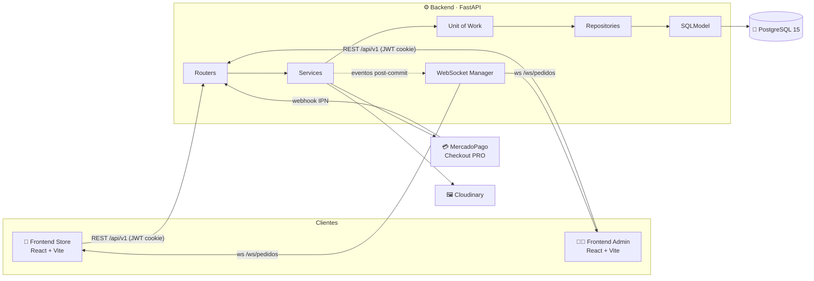
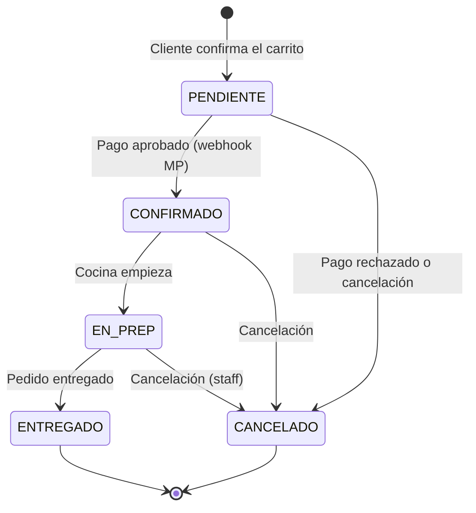
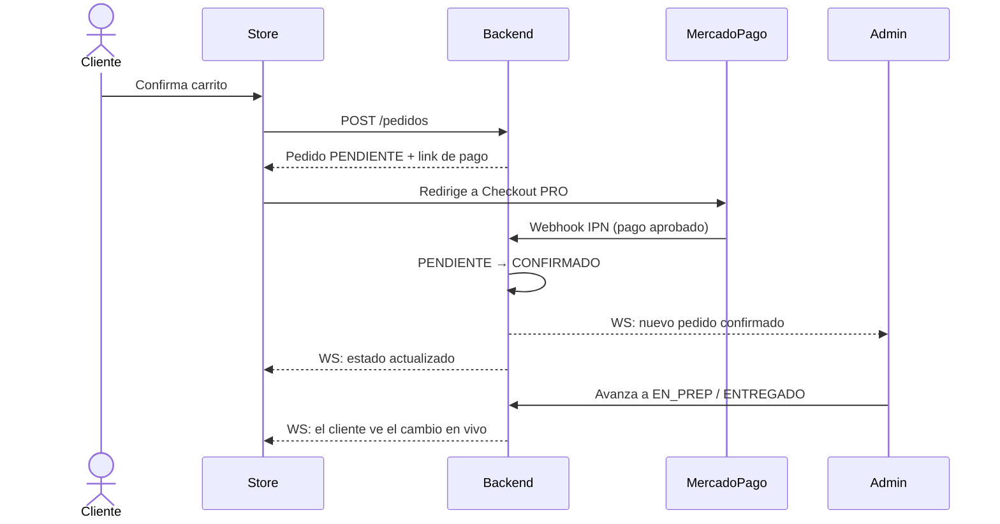

<div align="center">

# 🍔 FoodStore

### Plataforma full‑stack de pedidos de comida online

Catálogo, carrito, pagos con **MercadoPago**, seguimiento de pedidos **en tiempo real** y un panel de administración con métricas de negocio.

<br/>

[](https://github.com/IgnacioOdorico/FoodStore-BACKEND)
[](https://github.com/IgnacioOdorico/FoodStore-FRONTEND-STORE)
[](https://github.com/IgnacioOdorico/FoodStore-FRONTEND-ADMIN)
[](https://www.youtube.com/watch?v=IghWtxwE6Ts)

<br/>


</div>

---

## 📑 Contenido

- [¿Qué es FoodStore?](#-qué-es-foodstore)
- [Los 3 repositorios](#-los-3-repositorios)
- [Arquitectura general](#️-arquitectura-general)
- [Funcionalidades](#-funcionalidades)
- [Flujo de un pedido](#-flujo-de-un-pedido)
- [Roles y permisos](#-roles-y-permisos)
- [Stack tecnológico](#-stack-tecnológico)
- [Cómo levantar todo el proyecto](#-cómo-levantar-todo-el-proyecto)
- [Demo en video](#-demo-en-video)

---

## 🧭 ¿Qué es FoodStore?

**FoodStore** es un sistema completo de venta de comida online, dividido en tres aplicaciones que trabajan juntas:

- 🛒 Una **tienda** donde los clientes navegan el catálogo, arman su carrito, pagan con MercadoPago y siguen el estado de su pedido en vivo.
- 🧑‍💼 Un **panel de administración** donde el equipo gestiona productos, categorías, ingredientes, stock, usuarios y pedidos, con un dashboard de ventas.
- ⚙️ Una **API REST + WebSocket** que concentra toda la lógica de negocio, la seguridad y las integraciones externas.

---

## 📦 Los 3 repositorios

<table>
  <tr>
    <td align="center" width="33%">
      <h3>⚙️ Backend</h3>
      <p>API REST + WebSocket con FastAPI, PostgreSQL, JWT + RBAC, MercadoPago y Cloudinary.</p>
      <a href="https://github.com/IgnacioOdorico/FoodStore-BACKEND">
        
      </a>
    </td>
    <td align="center" width="33%">
      <h3>🛒 Frontend Store</h3>
      <p>La tienda para clientes: catálogo, carrito persistente, checkout y seguimiento de pedidos.</p>
      <a href="https://github.com/IgnacioOdorico/FoodStore-FRONTEND-STORE">
        
      </a>
    </td>
    <td align="center" width="33%">
      <h3>🧑‍💼 Frontend Admin</h3>
      <p>Panel de gestión: CRUDs, stock, pedidos en vivo, usuarios y dashboard con métricas.</p>
      <a href="https://github.com/IgnacioOdorico/FoodStore-FRONTEND-ADMIN">
        
      </a>
    </td>
  </tr>
</table>

---

## 🏗️ Arquitectura general



El backend sigue una **arquitectura en capas** (`Router → Service → UoW → Repository → Model`): los routers sólo hablan HTTP, la lógica de negocio vive en servicios stateless, y el **Unit of Work** garantiza transacciones atómicas. Los frontends están organizados **por features** (dominio), con estado de servidor en TanStack Query y estado de cliente en Zustand.

---

## ✨ Funcionalidades

<table>
<tr>
<td valign="top" width="50%">

### 🛒 Tienda (clientes)

- 🔐 Registro, login y perfil de usuario
- 🍕 Catálogo con búsqueda, filtros por categoría y detalle de producto
- 🥜 Ingredientes y **alérgenos** visibles en cada producto
- 🧺 Carrito **persistente** (sobrevive a recargas)
- 💳 Pago con **MercadoPago Checkout PRO**
- 📍 Direcciones de entrega con dirección principal
- 📦 Historial de pedidos con cancelación (mientras esté pendiente o confirmado)
- ⚡ Estado del pedido actualizado **en tiempo real**

</td>
<td valign="top" width="50%">

### 🧑‍💼 Panel Admin (equipo)

- 📊 **Dashboard** con ventas, ingresos, top productos y pedidos por estado
- 🗂️ Categorías **jerárquicas** con imagen en Cloudinary
- 🍔 CRUD de productos, ingredientes y stock
- 🚚 Gestión de pedidos con **feed en vivo** vía WebSocket
- 👥 Administración de usuarios y roles
- 🛡️ Rutas protegidas según rol (ADMIN, STOCK, PEDIDOS)
- 🔔 Notificaciones toast y tablas con filtros

</td>
</tr>
</table>

### 🔒 Seguridad y calidad (backend)

| | |
|---|---|
| 🔑 **Autenticación** | JWT con access + refresh token en cookie |
| 🛡️ **Autorización** | RBAC con 4 roles |
| 🧂 **Contraseñas** | Hash con bcrypt (cost ≥ 12) |
| 🚦 **Rate limiting** | 5 intentos de login cada 15 minutos |
| ⚠️ **Errores** | Respuestas estandarizadas según RFC 7807 |
| 🧾 **Auditoría** | Historial de cambios de estado de cada pedido |
| 🧪 **Tests** | Pytest unitarios e integración |

---

## 🔄 Flujo de un pedido

Los pedidos se gobiernan con una **máquina de estados (FSM)**: sólo se permiten transiciones válidas y cada cambio queda registrado y se notifica por WebSocket.





---

## 👥 Roles y permisos

| Rol | Código | Acceso |
|---|---|---|
| 👑 Administrador | `ADMIN` | Todo el sistema: dashboard, usuarios, catálogo y pedidos |
| 📦 Gestor de Stock | `STOCK` | Productos, categorías, ingredientes y stock |
| 🚚 Gestor de Pedidos | `PEDIDOS` | Ver y avanzar estados de pedidos |
| 🙋 Cliente | `CLIENT` | Tienda: catálogo, carrito y sus propios pedidos |

---

## 🧰 Stack tecnológico

<table>
<tr>
<th>⚙️ Backend</th>
<th>🎨 Frontends</th>
<th>☁️ Infra e integraciones</th>
</tr>
<tr>
<td valign="top">

- Python 3.10+
- FastAPI (REST + WebSocket + OpenAPI)
- SQLModel + Pydantic
- PostgreSQL 15
- Alembic (migraciones)
- python-jose (JWT) + Passlib/bcrypt
- Pytest

</td>
<td valign="top">

- React 19 + TypeScript
- Vite 8
- Tailwind CSS 4
- React Router 7
- TanStack Query / Form / Table
- Zustand
- Axios con interceptores
- Recharts + Tremor (dashboard)
- Sonner + Lucide

</td>
<td valign="top">

- Docker Compose
- ngrok (webhooks en desarrollo)
- MercadoPago Checkout PRO
- Cloudinary (imágenes)

</td>
</tr>
</table>

---

## 🚀 Cómo levantar todo el proyecto

> Requisitos: **Python 3.10+**, **Node.js 20+**, **pnpm 9+** (o npm) y **Docker**.

### 1️⃣ Clonar los tres repositorios

```bash
git clone https://github.com/IgnacioOdorico/FoodStore-BACKEND.git
git clone https://github.com/IgnacioOdorico/FoodStore-FRONTEND-STORE.git
git clone https://github.com/IgnacioOdorico/FoodStore-FRONTEND-ADMIN.git
```

### 2️⃣ Backend

```bash
cd FoodStore-BACKEND
cp .env.example .env          # completar credenciales (Postgres, JWT, MercadoPago, Cloudinary, ngrok)
docker-compose up -d          # PostgreSQL + ngrok
python -m venv .venv
.venv\Scripts\activate        # Linux/macOS: source .venv/bin/activate
pip install -r requirements.txt
python -m app.db.seed         # roles, estados, formas de pago y usuario admin
uvicorn app.main:app --reload
```

📘 Documentación interactiva en **http://localhost:8000/docs**

### 3️⃣ Frontend Store

```bash
cd FoodStore-FRONTEND-STORE
pnpm install
cp .env.example .env          # VITE_API_URL=http://localhost:8000/api/v1
pnpm dev
```

### 4️⃣ Frontend Admin

```bash
cd FoodStore-FRONTEND-ADMIN
pnpm install
cp .env.example .env
pnpm dev
```

> 💡 Vite toma el siguiente puerto libre si `5173` ya está ocupado, así que podés correr ambos frontends a la vez.

Cada repositorio tiene su propio README con el detalle completo de configuración, estructura de carpetas y variables de entorno.

---

## 🎬 Demo en video

<div align="center">

[](https://www.youtube.com/watch?v=IghWtxwE6Ts)

▶️ [Demo principal](https://www.youtube.com/watch?v=IghWtxwE6Ts) · ➕ [Video complementario](https://www.youtube.com/watch?v=xzheMmXe0Uc)

</div>

---

<div align="center">

Hecho con ☕ y 🍔 por **[Ignacio Odorico](https://github.com/IgnacioOdorico)**

</div>
